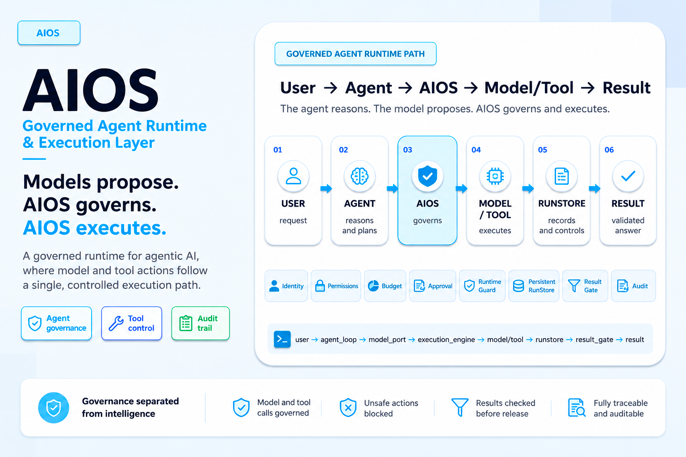
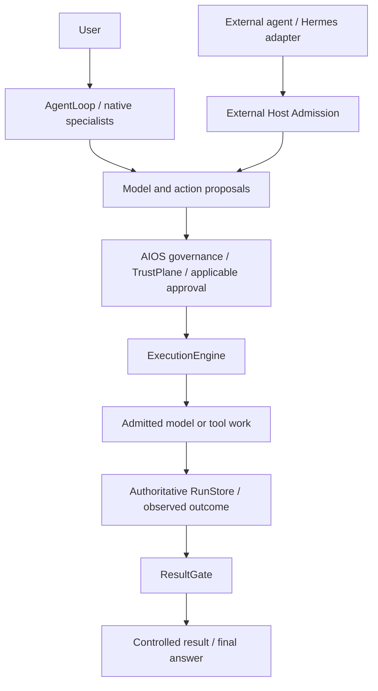
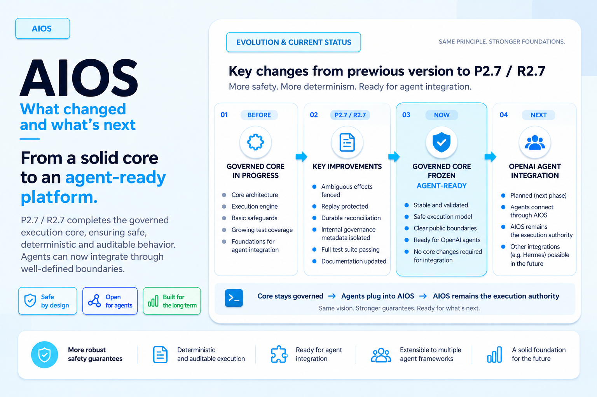

# AIOS — Governed Agent Runtime & Execution Layer



> **Models propose. AIOS governs. AIOS executes.**

## What AIOS Is

AIOS is a governed agent runtime and execution layer. It separates model proposals and agent coordination from the authority to execute actions, records execution truth independently of the conversation, and controls which results may be released.

This repository contains public technical documentation, aggregate evidence and a runnable V2 demonstration. The V3 product runtime remains private under [bounded technical disclosure](docs/public-vs-private-boundary.md).

## Current Status

**Reviewed 13 October 2026 · RM-21 ACCEPTED OFFLINE for its corrected candidate · RM-22 BLOCKED before LIVE.**

The private track has progressed beyond P3 and EA-0B: installed host lifecycle, approval administration, execution-history integrity, conservative failure operations, backup/restore, a gateway client, and a governed Hermes plugin are implemented and verified in their declared scopes. RM-21's final decision of **8 October 2026** qualifies an identified corrected development candidate offline. Later local RM-22 preparation has narrower passing functional evidence and open deployment/provider/authorization gates.

**OpenAI integration:** the OpenAI Python SDK and Responses API support the implemented model provider. AIOS owns native orchestration. **OpenAI Agents SDK remains deferred and not implemented.** The Hermes governed plugin is implemented and verified offline; provider-live and production Hermes qualification remain open.

[](docs/public/aios-v3/AIOS_V3_RELEASE_QUALIFICATION.md)
[](docs/public/aios-v3/AIOS_V3_RELEASE_QUALIFICATION.md#rm-22-narrow-progress-open-gates)
[](docs/public/aios-v3/AIOS_V3_CURRENT_EVIDENCE.md)
[](docs/public/aios-v3/AIOS_V3_STATUS_AND_LIMITS.md)
[](docs/public/aios-v3/AIOS_V3_POST_CORE_EVIDENCE.md)
[](docs/public-vs-private-boundary.md)
[](docs/public/aios-v2/README.md)

[Latest qualification and integration record](docs/public/aios-v3/AIOS_V3_RELEASE_QUALIFICATION.md) · [Evaluator guide](FOR_EVALUATORS.md) · [Architecture](docs/public/aios-v3/AIOS_V3_ARCHITECTURE.md) · [Status and limits](docs/public/aios-v3/AIOS_V3_STATUS_AND_LIMITS.md) · [Roadmap](docs/roadmap.md)

## What AIOS Actually Does

An agent proposes work. AIOS checks whether that work is admitted under the applicable policy, capability, budget and approval, executes the admitted action, records the observed outcome and controls result release. The following describes architectural roles, not internal interfaces or an implementation recipe.

| Component | Practical role |
| --- | --- |
| `AgentLoop` / native multi-agent | Coordinates bounded turns and specialist roles; coordination grants no execution authority. |
| `ModelPort` / governed inference | Keeps provider concerns separate and routes model work through governance. |
| `GovernedActionPort` | Carries proposals toward the existing governed authority path. |
| `ExecutionEngine` | Admits and executes governed model and tool work. |
| `TrustPlane` / approval | Keeps trusted host authority separate from agent claims and binds approval to the admitted action. |
| SQLite `RunStore` | Preserves authoritative execution truth independently of conversation state. |
| `ResultGate` | Controls outward result release; a tool's output alone does not prove success. |
| External Agent Adapters | Translate bounded external proposals; they cannot approve or execute effects directly through this path. |
| Recovery / replay | Uses authoritative state and stops blind repetition when an effect is uncertain. |

## Governed Execution Backbone

### Current V3 architecture



This is a high-level authority and data-flow diagram. Model calls and tool calls are governed work; external provenance and persuasive text do not create authority. Private schemas, contracts, approval mechanisms and deployment wiring remain private.

### V2 public backbone

```text
request -> planner -> execution_engine -> tool_registry -> runtime_guard -> tool -> result_gate -> result
```

The public mock preserves this V2 path. Its safety corrections improve the demonstration without turning it into a private V3 replica.

## External Agent / Host Governance

EA-0A and EA-0B established scoped external proposal admission, governed READ, approval-bound WRITE, replay/restart and tested macOS two-principal isolation. RM-17 added the gateway client; RM-18 added an actual Hermes plugin; RM-21 verified the installed local host/registry boundary offline using synthetic resources and real local processes.

Hermes remains a proposer. AIOS retains policy, capability, budget, approval, execution, replay, recovery and result-release authority. Earlier Hermes A/B decision-source experiments remain historical evidence, distinct from the implemented plugin and from a future provider-live qualification.

[External Host Evidence](docs/public/aios-v3/AIOS_V3_EXTERNAL_HOST_EVIDENCE.md) · [Historical Hermes experiments](docs/public/aios-v3/AIOS_V3_POST_CORE_EVIDENCE.md) · [Current integration status](docs/public/aios-v3/AIOS_V3_RELEASE_QUALIFICATION.md#integration-status)

## Current V3 Evidence



| Capability | Implemented / verified state | Limit |
| --- | --- | --- |
| Governed execution, AgentLoop and inference | Implemented; offline and bounded historical provider-live evidence | AIOS native orchestration, not OpenAI Agents SDK. |
| Governed READ and bounded WRITE | Verified in successive named scopes; corrected installed host qualified by RM-21 | Explicit approval where required; no arbitrary filesystem access. |
| Persistent approval binding, replay and crash recovery | Implemented and tested in declared persistence scopes | `UNKNOWN_EFFECT` remains terminal against blind re-execution; no distributed exactly-once claim. |
| SQLite RunStore and ResultGate | Implemented; authoritative truth and controlled result release | Conversation state and agent claims cannot substitute for execution evidence. |
| macOS host isolation | Verified in named local two-principal profiles | Neither a universal sandbox nor qualification of later changed deployments. |
| Hermes plugin and gateway client | Implemented and offline verified | Production and provider-live qualification remain open. |
| OpenAI Agents SDK | Planned / explicitly deferred | OpenAI API SDK use is a separate implemented integration. |
| RM-22 campaign preparation | Narrow offline functional progress | Overall BLOCKED before LIVE; no approved spend or final release. |

### Separate verification snapshots

| Milestone and date | Result | Scope |
| --- | --- | --- |
| Historical P2.7/R2.7 | **2,510 passed, 1 skipped; 11,350 subtests passed** | Private `tests_v2 + tests_v3`; targeted closeout separately **5 passed**. |
| P3, 29 September 2026 | **1,753 passed, 1 skipped; 1,209 subtests passed** | Private `tests_v3`; sequential multi-agent, distinct historical live pilot. |
| EA-0B Slice 3, 30 September 2026 | **2,888 collected; 2,887 passed; 1 skipped; 12,407 subtests passed** | Separate canonical full-repository run. |
| **RM-21, 8 October 2026** | **3,233 passed, 0 failed, 1 skipped; 13,654 subtests passed; exit 0** | Corrected candidate, clean private `tests_v2 + tests_v3`. |
| **RM-21 installed package, 8 October 2026** | **202 passed, 0 failed, 0 skipped; exit 0** | Identified installed candidate outside the checkout. |

Counts are never summed. The RM-21 skip requires a case-sensitive volume unavailable on that host. Parent-only coverage and functional process evidence are separately delimited in the [qualification record](docs/public/aios-v3/AIOS_V3_RELEASE_QUALIFICATION.md). The final operational controller did not finish every scenario; only its reached subset was asserted passing, with remaining applicable properties checked at their stated levels.

The historical P2 OpenAI pilot and P3 multi-agent pilot were real provider runs on bounded synthetic tasks. RM-21 is an offline qualification, even where actual local processes and OS principals were used. No private suite or provider call was executed for this public refresh. Historical evidence does not qualify the locally modified RM-22 candidate.

## V2 Historical Evidence Preserved

AIOS V2 remains documented as **AIOS V2 — Governed Execution Backbone**. The complete public V2 package, field tests, proof tests, and demonstration runtime remain in this repository as evidence of the preceding phase.

### At-most-once execution evidence

The V2 private enterprise runtime was adversarially validated within its declared persistent-runtime scope against duplicate ownership and blind re-execution. When an effect may have occurred but the outcome cannot be proven, the documented runtime converges to `UNKNOWN_EFFECT` rather than automatically retrying.

| V2 evidence | Historical result |
| --- | --- |
| At-most-once semantics | Verified in the declared V2 persistent-runtime scope |
| Concurrent duplicate callers | Blocked from duplicate ownership/execution |
| Repeated race validation | **125/125 passed** |
| V2 private enterprise suite snapshot | **927 tests passed + 6525 subtests passed** |
| Accounting/audit convergence | **PARTIAL** |
| Distributed/multi-host guarantee | **NOT CLAIMED** |

[Read the V2 at-most-once evidence](docs/public/aios-v2/AT_MOST_ONCE_EXECUTION_EVIDENCE.md).

## Proposed Restack Project — Separate Open Kernel

The **Open Governed Capability Execution Kernel** is a proposed future Restack project, not a claim about functionality already implemented in this repository. The proposed work would extract and develop a standalone, model-neutral capability-execution kernel for general networked software. It would govern explicitly declared capabilities, authorization, execution state, audit evidence, result release, and fail-closed recovery without requiring an AI model, an agent framework, OpenAI, or the private AIOS V3 runtime.

If selected, all software, tests, specifications, documentation, and other project results funded through Restack would be developed publicly and released in their entirety under the Apache License 2.0. The funded scope would exclude LLM or model development, integration, evaluation, and AI-specific orchestration. Existing AIOS material would provide background and prior engineering evidence only; it would not be a closed dependency of the proposed kernel.

[Read the proposed Restack project boundary](docs/public/restack/OPEN_GOVERNED_CAPABILITY_EXECUTION_KERNEL.md).

### ANDY controlled field tests

- The 2026-05-17 controlled Docker field test reported **13/13 checks passed**, with governed requests routed through AIOS, blocked cases remaining non-executed, and no direct bypass observed in that scope.
- The 2026-05-22 controlled Docker/VPS bypass-attempt follow-up reported **8/8 scenarios PASS**, with no useful action observed outside the governed backbone and no execution recorded outside the governed route.

These are controlled V2 field-test snapshots, not production-readiness or security-certification claims.

- [ANDY controlled field-test evidence](docs/public/field-tests/andy-aios-2026-05-17/README.md)
- [ANDY bypass-attempt evidence](docs/public/field-tests/andy-backbone-bypass-2026-05-22/ANDY_BACKBONE_BYPASS_ATTEMPT_EVIDENCE.md)
- [V2 public proof tests](docs/public-proof-tests/README.md)
- [V2 external public-mock validation](docs/public/aios-v2/AIOS_EXTERNAL_PIPELINE_VALIDATION.md)

## Quick Links

| Area | Link |
| --- | --- |
| External agent / host governance | [AIOS_V3_EXTERNAL_HOST_EVIDENCE.md](docs/public/aios-v3/AIOS_V3_EXTERNAL_HOST_EVIDENCE.md) |
| Proposed Restack project boundary | [Open Governed Capability Execution Kernel](docs/public/restack/OPEN_GOVERNED_CAPABILITY_EXECUTION_KERNEL.md) |
| Evaluator guide | [FOR_EVALUATORS.md](FOR_EVALUATORS.md) |
| AIOS in 5 minutes | [docs/public/AIOS_IN_5_MINUTES.md](docs/public/AIOS_IN_5_MINUTES.md) |
| V3 public index | [docs/public/aios-v3/README.md](docs/public/aios-v3/README.md) |
| Current V3 evidence | [AIOS_V3_CURRENT_EVIDENCE.md](docs/public/aios-v3/AIOS_V3_CURRENT_EVIDENCE.md) |
| V3 architecture | [AIOS_V3_ARCHITECTURE.md](docs/public/aios-v3/AIOS_V3_ARCHITECTURE.md) |
| V3 status and limits | [AIOS_V3_STATUS_AND_LIMITS.md](docs/public/aios-v3/AIOS_V3_STATUS_AND_LIMITS.md) |
| Historical P0 evidence | [AIOS_V3_P0_EVIDENCE.md](docs/public/aios-v3/AIOS_V3_P0_EVIDENCE.md) |
| Integration model | [docs/public/AIOS_INTEGRATION_MODEL.md](docs/public/AIOS_INTEGRATION_MODEL.md) |
| Roadmap | [docs/roadmap.md](docs/roadmap.md) |
| V2 historical index | [docs/public/aios-v2/README.md](docs/public/aios-v2/README.md) |
| Public/private boundary | [docs/public-vs-private-boundary.md](docs/public-vs-private-boundary.md) |

## Why Agent Governance Needs A Runtime

The risk changes when AI moves from answer to action. A model that can request tools, files, APIs, databases, or business workflows can create effects before the final answer is reviewed.

Direct model-to-tool patterns are useful prototypes, but the model should not be the final authority over execution. AIOS puts an independent runtime boundary between a proposal and its operational effect, then keeps result release and authoritative execution state inside that governed path.

| Concern | Direct agent path | AIOS-governed path |
| --- | --- | --- |
| Model output | Proposal can become action | Proposal remains non-authoritative |
| Model and tool calls | May use separate or implicit paths | Both traverse the governed backbone |
| Execution authority | Can be blurred into orchestration | Remains with `ExecutionEngine` |
| Approval | May be implicit in the request | Applied explicitly where the governed action requires it |
| Recovery | Retry may duplicate an uncertain effect | Fail-closed recovery and `UNKNOWN_EFFECT` block blind retry |
| State | Conversation and execution may be conflated | Conversation state and execution truth remain separate |
| Results | Output may be returned directly | `ResultGate` controls outward release |
| Evidence | Hard to reconstruct | Run state and audit remain reviewable |

## What Can Be Tested

The public executable surface remains V2-shaped and requires only **Python 3.11 or later**, without provider credentials or third-party packages.

| Testable area | Where |
| --- | --- |
| ALLOW/WARN/BLOCK, read-only demo and stable errors | [Public mock runtime](public_mock_runtime/README.md) |
| Public backbone consistency and synthetic JSON examples | [Backbone guide](backbone_public_test/README.md) |
| Input/rule validation and path containment regressions | [Independent public regressions](tests/test_mock_runtime_safety.py) |
| Local Markdown targets and heading anchors | [Offline checker](scripts/check_markdown_links.py) |
| Result redaction and approval without automatic runtime effect | [Examples](examples/) |
| Historical proof artifacts | [V2 public proofs](docs/public-proof-tests/README.md) |

```bash
python3 -B -m unittest discover -s tests -v
python3 -B -m unittest discover -s public_mock_runtime/proof_tests -v
python3 -B scripts/check_markdown_links.py
python3 public_mock_runtime/mock_runtime.py public_mock_runtime/examples/allow.json
python3 public_mock_runtime/mock_runtime.py public_mock_runtime/examples/warn.json
python3 public_mock_runtime/mock_runtime.py public_mock_runtime/examples/block.json
```

The BLOCK example intentionally exits with code 1 before tool execution. GitHub Actions runs the public test/check commands on Python 3.11 and 3.13; hosted results are pending until publication and execution. The V3 suite and source remain private; public mock tests cannot reproduce private qualification.

## What Is Public Here

- High-level V3 architecture, status, aggregate milestone results and explicit limits.
- Historical V2 documentation, proof tests, synthetic examples and sanitized field tests.
- A small V2-shaped executable mock and independent public regressions.
- An offline link checker and CI configuration without provider credentials.

## What Is Not Public

- V3 source code or private implementation details;
- private test source or fixtures;
- raw `RunStore` schema;
- private authorization, approval, and trust-boundary mechanisms;
- detailed exploit or adversarial probes;
- private prompts or operator internals;
- local paths, credentials, or credential fragments;
- raw audit records, logs, or traces;
- private configuration or deployment internals.

This is **bounded technical disclosure**: public properties, architecture, and aggregate evidence without a public replica of the private runtime.

## Public Presentation

The existing presentation is an AIOS V2 historical artifact. It explains the governed execution concept and remains available without being relabeled as a V3 runtime publication.

[Download the AIOS V2 Governed AI Execution Layer PDF](docs/public/AIOS_Governed_AI_Execution_Layer.pdf).

## Repository Map

| Path | Purpose |
| --- | --- |
| [FOR_EVALUATORS.md](FOR_EVALUATORS.md) | Guided review path for technical and grant evaluators |
| [docs/public/aios-v3/](docs/public/aios-v3/) | Current V3 architecture, evidence, status, and limits |
| [docs/public/aios-v2/](docs/public/aios-v2/) | Preserved V2 historical documentation and evidence |
| [docs/public/field-tests/](docs/public/field-tests/) | Sanitized V2 ANDY field-test evidence |
| [docs/public-proof-tests/](docs/public-proof-tests/) | Preserved V2 public proof artifacts |
| [public_mock_runtime/](public_mock_runtime/) | Minimal V2-shaped executable demonstration |
| [backbone_public_test/](backbone_public_test/) | V2 backbone consistency guide |
| [examples/](examples/) | Curated V2 public JSON cases |
| [tests/](tests/) | Public invariant tests for the V2 demonstration surface |
| [reference/](reference/) | Version-aware glossary and public invariants |

## What Comes Next

Finish the remaining RM-22 candidate/deployment and provider-accounting gates, freeze the qualified candidate, and obtain explicit economic authorization before a paid LIVE qualification. OpenAI Agents SDK and other unqualified adapters remain future work. Publishing this public refresh is a separate owner-approved step.

[Roadmap](docs/roadmap.md) · [Current limits](docs/public/aios-v3/AIOS_V3_STATUS_AND_LIMITS.md)

## Status

**RM-21 ACCEPTED within its identified offline scope; RM-22 BLOCKED before LIVE.** The private development package is not a final production release. Accepted milestones, isolated passing suites and historical pilots do not establish production readiness, certification, universal security or distributed exactly-once behavior.

## License

This repository is released under the [MIT License](LICENSE).
